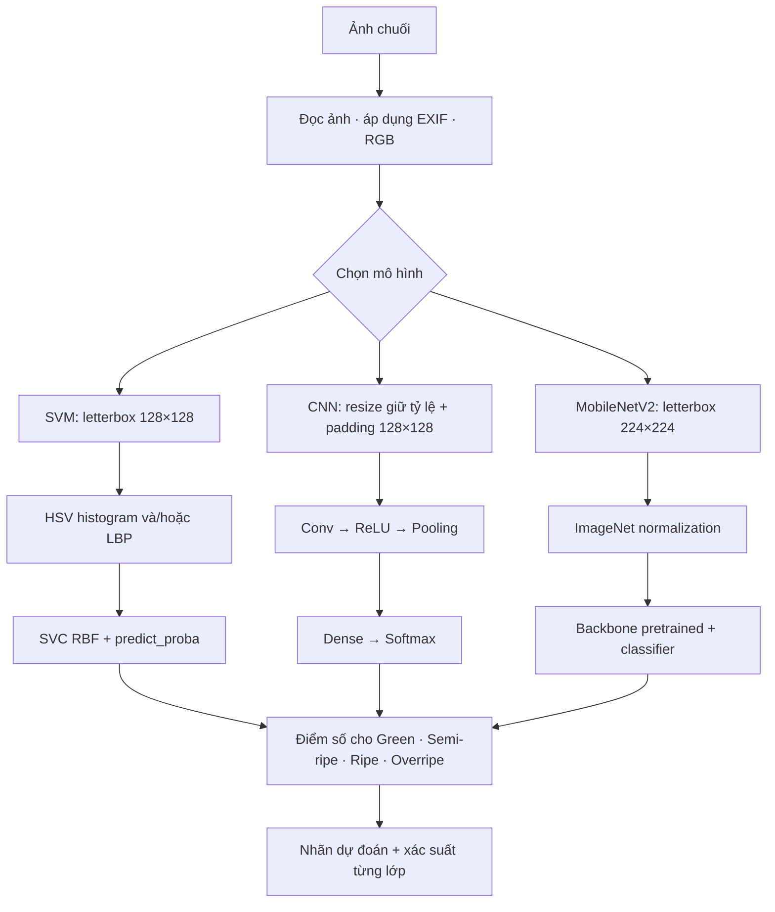
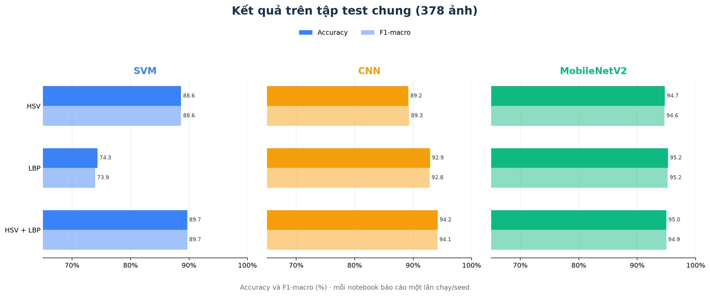

<div align="center">

# 🍌 Banana Ripeness Classification
### Nhận diện độ chín của chuối bằng thị giác máy tính

**SVM · CNN · MobileNetV2**
Từ một ảnh đầu vào đến dự đoán bốn giai đoạn chín.


</div>

## 1. Giới thiệu

Bài toán đặt ra là xác định độ chín của trái chuối dựa trên hình ảnh. Hệ thống phân loại ảnh thành bốn lớp: **Green** (xanh), **Semi-ripe** (chín vừa), **Ripe** (chín) và **Overripe** (quá chín).

Để giải quyết bài toán, dự án khảo sát ba hướng thị giác máy tính:

- **SVM** kết hợp bộ phân loại RBF với đặc trưng màu HSV và kết cấu LBP.
- **CNN** học đặc trưng trực tiếp từ pixel ảnh qua các lớp tích chập.
- **MobileNetV2** sử dụng backbone pretrained trên ImageNet, sau đó đóng băng hoặc fine-tune một phần để phân loại bốn lớp.

## 2. Kiến trúc pipeline



### Luồng xử lý ảnh chung

Ảnh đầu vào được đọc, xoay đúng chiều theo EXIF và chuyển sang RGB. Mỗi họ model có cách chuẩn hóa riêng để khớp với quy trình đã dùng khi huấn luyện. Sau khi suy luận, model trả điểm cho bốn lớp; giao diện chọn lớp có điểm cao nhất và hiển thị xác suất của từng lớp.

### SVM — đặc trưng thủ công rồi phân loại

1. Chuyển ảnh RGB sang BGR và resize giữ nguyên tỷ lệ vào khung **128×128**, phần trống được padding màu đen. Một mask đánh dấu vùng ảnh thật để phần padding không làm sai histogram.
2. Tính một trong ba bộ đặc trưng:
   - **HSV:** histogram màu Hue/Saturation, 128 chiều.
   - **LBP:** histogram kết cấu Local Binary Patterns, 10 chiều.
   - **HSV + LBP:** nối hai bộ đặc trưng, 138 chiều.
3. Bộ phân loại **SVC với kernel RBF** chọn lớp. Checkpoint bật `probability=True`, nên `predict_proba` trả xác suất ước lượng cho cả bốn lớp.

**LBP (Local Binary Patterns)** mô tả hoa văn cục bộ của ảnh, còn **HSV** biểu diễn sắc độ và độ bão hòa màu. Đây là các đặc trưng được tính trước; SVM không tự học đặc trưng trực tiếp từ pixel như CNN.

### CNN — học đặc trưng từ ảnh

Ảnh RGB được resize giữ tỷ lệ và padding vào khung **128×128**, sau đó pixel được đưa về khoảng 0–1. Các lớp convolution học những mẫu ảnh từ đơn giản đến phức tạp; ReLU tạo phi tuyến, còn max pooling giảm kích thước bản đồ đặc trưng. Lớp cuối dùng **Softmax** để tạo xác suất cho bốn lớp.

Ba cấu hình trong notebook:

- **A_slide:** hai lớp convolution (6 và 16 filters), sau đó Flatten và các lớp Dense.
- **B_features:** ba khối convolution (32, 64, 128 filters), Global Average Pooling và Dense.
- **C_bn_dropout:** kiến trúc B bổ sung **Batch Normalization (BN)** và **Dropout 20%**. BN chuẩn hóa activation trong quá trình huấn luyện; Dropout tạm tắt ngẫu nhiên một phần neuron khi huấn luyện để giảm overfitting. Hai kỹ thuật này không có nghĩa mô hình chắc chắn tốt hơn; cần xem kết quả đánh giá.

### MobileNetV2 — backbone pretrained và fine-tuning

Ảnh RGB được resize giữ tỷ lệ, padding vào khung **224×224**, rồi chuẩn hóa bằng mean/std của ImageNet. Backbone MobileNetV2 trích đặc trưng; classifier cuối được thay bằng lớp dự đoán bốn giai đoạn chín.

- **MobileNetV2.1 — Frozen Backbone:** đóng băng backbone pretrained; chỉ huấn luyện classifier mới.
- **MobileNetV2.2 — Fine-tuning:** mở một phần các tầng cuối của backbone cùng classifier để thích nghi với ảnh chuối.
- **MobileNetV2.3 — Fine-tuning + Augmentation:** cấu hình fine-tuning như bản 2, đồng thời tăng cường dữ liệu nhẹ chỉ trên tập train (lật ngang và affine nhẹ).

**Fine-tuning** là tiếp tục cập nhật một phần trọng số pretrained trên dữ liệu mục tiêu. **Augmentation** tạo biến thể ảnh trong lúc huấn luyện để model gặp nhiều tình huống hơn; validation và test không dùng augmentation ngẫu nhiên.

### Kết quả trên tập test

Các notebook dùng cùng manifest và **378 ảnh test**. Bảng dưới tổng hợp Accuracy và F1-macro được báo cáo cho từng biến thể.



| Họ model | Phiên bản | Accuracy | F1-macro |
|---|---|---:|---:|
| SVM | HSV | 88.62% | 88.63% |
| SVM | LBP | 74.34% | 73.94% |
| SVM | HSV + LBP | 89.68% | 89.69% |
| CNN | A_slide | 89.15% | 89.29% |
| CNN | B_features | 92.86% | 92.80% |
| CNN | C_bn_dropout | 94.18% | 94.14% |
| MobileNetV2 | 1 · Frozen Backbone | 94.71% | 94.64% |
| MobileNetV2 | 2 · Fine-tuning | 95.24% | 95.21% |
| MobileNetV2 | 3 · Fine-tuning + Augmentation | 94.97% | 94.94% |

Mỗi notebook hiện báo cáo một lần chạy/seed; các con số mô tả kết quả trên split test này, không phải cam kết hiệu năng trên mọi ảnh thực tế.

## 3. Hướng dẫn cài đặt & vận hành

Từ Anaconda Prompt hoặc Miniconda Prompt:

```bash
git clone https://github.com/Thinhng04/CS231.git
cd CS231
conda create -n banana-demo python=3.11 -y
conda activate banana-demo
python -m pip install -r requirements-models.txt
python server.py
```

Khi server khởi động, mở **http://127.0.0.1:8000** trên trình duyệt. Tải ảnh chuối lên, chọn họ và phiên bản model, rồi nhấn **Phân tích ảnh**. Dừng server bằng `Ctrl+C` trong cửa sổ terminal.

## 4. Cấu trúc thư mục

```text
CS231/
├── README.md                   # Giới thiệu, pipeline, kết quả và hướng dẫn chạy
├── server.py                   # HTTP server local và các API
├── inference.py                # Tiền xử lý, nạp model và dự đoán
├── models.json                 # Danh mục model, nhãn và đường dẫn checkpoint
├── requirements.txt            # Dependencies nền tảng
├── requirements-models.txt     # Dependencies cho SVM, CNN, MobileNetV2
├── start.bat                   # Khởi động server trên Windows
├── models/                     # Checkpoint đã huấn luyện
│   ├── svm_*.joblib
│   ├── cnn_*.keras
│   └── mobilenet_*_best.pth
├── static/                     # Giao diện web
│   ├── index.html
│   ├── app.js
│   └── style.css
├── notebook/                   # Notebook, kết quả thí nghiệm và biểu đồ
│   ├── svm.ipynb
│   ├── cnn.ipynb
│   ├── mobilenet.ipynb
│   ├── *_result.zip
│   └── model_comparison_test.png
└── tests/                      # Mã kiểm tra API và xử lý ảnh
```
