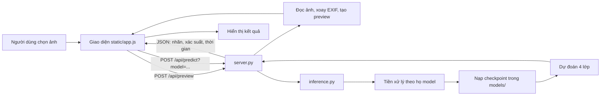

# Nhận diện độ chín của chuối

## 1. Giới thiệu

Đây là đồ án môn **CS231 – Nhập môn Thị giác máy tính**, Trường Đại học Công nghệ Thông tin – Đại học Quốc gia TP. Hồ Chí Minh (UIT – VNUHCM). Đồ án xây dựng hệ thống phân loại độ chín của chuối từ ảnh và so sánh ba hướng tiếp cận: **SVM**, **CNN** và **MobileNetV2**.

Web demo cho phép tải ảnh chuối lên, chọn họ mô hình và xem dự đoán cho bốn lớp: `Green`, `Semi-ripe`, `Ripe` và `Overripe`. Các mô hình đã huấn luyện được cung cấp trong thư mục `models/`; người dùng không cần tải dataset hoặc huấn luyện lại để chạy demo. Ảnh tải lên được xử lý trên máy local.

## 2. Kiến trúc pipeline



1. **Giao diện** (`static/`) tải danh sách model từ `GET /api/models`, nhận ảnh từ người dùng và gửi ảnh đến server.
2. **Server** (`server.py`) phục vụ trang web và cung cấp ba API: `/api/models`, `/api/preview`, `/api/predict`. Server kiểm tra ảnh, giới hạn kích thước và chuyển yêu cầu dự đoán cho phần inference.
3. **Inference** (`inference.py`) đọc cấu hình model trong `models.json`, tiền xử lý ảnh phù hợp với từng họ model, nạp checkpoint và chạy dự đoán.
4. **Kết quả** được server trả về dưới dạng JSON. Giao diện hiển thị lớp dự đoán, xác suất từng lớp và thời gian suy luận.

Tiền xử lý khác nhau theo mô hình: SVM trích đặc trưng HSV/LBP; CNN resize ảnh có giữ tỷ lệ; MobileNetV2 resize ảnh, thêm padding và chuẩn hóa theo ImageNet. Các xác suất là ước lượng của mô hình, không đảm bảo dự đoán luôn chính xác.

## 3. Hướng dẫn cài đặt & vận hành (step by step)

Hướng dẫn dưới đây dành cho Windows và người chạy demo lần đầu. Cần kết nối Internet trong bước cài thư viện. Máy không cần GPU, nhưng lần cài PyTorch/TensorFlow có thể mất vài phút và cần nhiều dung lượng.

### Bước 1: Cài công cụ

1. Cài **Python 3.11 64-bit** từ [python.org](https://www.python.org/downloads/). Trong trình cài đặt, chọn **Add Python to PATH**.
2. Cài **Git for Windows** từ [git-scm.com](https://git-scm.com/download/win).
3. Mở Command Prompt mới và kiểm tra Python:

   ```bat
   py -3.11 --version
   ```

   Nếu lệnh không chạy, cài lại Python và chọn **Add Python to PATH**.

### Bước 2: Tải project

Mở Command Prompt tại thư mục muốn lưu project, sau đó chạy:

```bat
git clone https://github.com/Thinhng04/CS231.git
cd CS231
```

### Bước 3: Tạo môi trường riêng

Tạo và kích hoạt môi trường Python riêng để các thư viện của demo không ảnh hưởng đến Python khác trên máy:

```bat
py -3.11 -m venv .venv
.venv\Scripts\activate
```

Khi môi trường được kích hoạt, đầu dòng lệnh thường có tiền tố `(.venv)`.

### Bước 4: Cài thư viện

```bat
python -m pip install --upgrade pip
python -m pip install -r requirements-models.txt
```

`requirements-models.txt` cài các thư viện cần để chạy đủ SVM, CNN và MobileNetV2. Nếu chỉ cài `requirements.txt`, các thư viện nền tảng được cài nhưng chưa đủ cho inference của các model.

### Bước 5: Khởi động web server

Trong cùng cửa sổ Command Prompt, khi `.venv` còn được kích hoạt, chạy:

```bat
python server.py
```

Server chạy mặc định tại `http://127.0.0.1:8000`. Mở địa chỉ này bằng trình duyệt. Giữ cửa sổ terminal mở trong lúc dùng web; quay lại terminal và nhấn `Ctrl+C` để dừng server.

Nếu cổng 8000 đang được ứng dụng khác sử dụng, chạy:

```bat
python server.py --port 8001
```

Sau đó mở `http://127.0.0.1:8001`.

### Bước 6: Thực hiện dự đoán

1. Nhấn vùng tải ảnh hoặc kéo thả ảnh chuối vào trang. Định dạng hỗ trợ: JPG, PNG, WEBP, BMP; dung lượng tối đa 15 MB.
2. Chọn họ model **SVM**, **CNN** hoặc **MobileNetV2**.
3. Chọn phiên bản model trong danh sách.
4. Nhấn **Phân tích ảnh**.
5. Xem lớp dự đoán, xác suất của bốn lớp, model được dùng và thời gian suy luận.

### Một số lỗi thường gặp

- **`No module named ...`:** kích hoạt `.venv` rồi chạy lại `python -m pip install -r requirements-models.txt`.
- **Model không khả dụng hoặc thiếu checkpoint:** xác nhận thư mục `models/` có các file tương ứng và project được tải đầy đủ.
- **Không mở được trang:** kiểm tra terminal còn chạy server; nếu đổi cổng, dùng đúng địa chỉ mới.
- **PowerShell không cho kích hoạt môi trường:** dùng Command Prompt như các bước trên, hoặc tiếp tục chạy trong Anaconda Prompt đã kích hoạt môi trường có đủ dependencies.

## 4. Cấu trúc thư mục

```text
CS231/
├── README.md                   # Giới thiệu, kiến trúc và hướng dẫn chạy
├── server.py                   # HTTP server local và các API
├── inference.py                # Tiền xử lý, nạp model và dự đoán
├── models.json                 # Danh mục model, nhãn và đường dẫn checkpoint
├── requirements.txt            # Dependencies nền tảng
├── requirements-models.txt     # Dependencies cho SVM, CNN, MobileNetV2
├── start.bat                   # Khởi động server trên Windows
├── models/                     # Checkpoint đã huấn luyện
│   ├── svm_*.joblib
│   ├── cnn_*.keras
│   └── mobilenet_*_best.pth
├── static/                     # Giao diện web
│   ├── index.html
│   ├── app.js
│   └── style.css
├── notebook/                   # Notebook và gói kết quả thí nghiệm
│   ├── svm.ipynb
│   ├── cnn.ipynb
│   ├── mobilenet.ipynb
│   ├── cnn_result.zip
│   ├── mobilenet_result.zip
│   └── svm_result.zip
└── tests/                      # Mã kiểm tra API và xử lý ảnh
```
